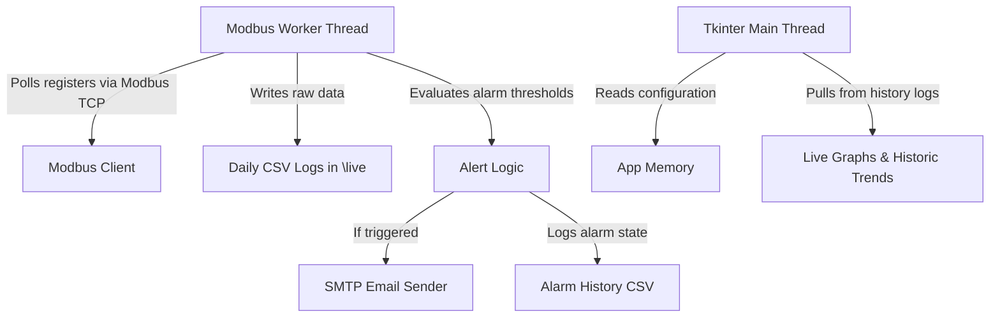

# Project Study: TempTrek Environmental Monitoring System v2

This document provides a comprehensive analysis of the codebase, design, configuration structures, and build environment of the **TempTrek Environmental Monitoring System v2**.

---

## 1. Project Overview & Architecture

TempTrek is a Python-based Tkinter GUI desktop application designed to monitor environmental sensors (such as temperature, voltage, frequency, and active power) over the **Modbus TCP** protocol.

### Key Components
1. **`2.py`**: The core application logic. It manages:
   - User authentication and permissions.
   - Modbus TCP connection polling (in background worker threads).
   - Real-time sensor data visualization (live trends & charts).
   - Email notification alert logic.
   - Historical data export (CSV and ReportLab-generated PDF).
2. **`unlock_data.py`**: Utility script to decrypt/deobfuscate the application's configuration files using the machine's Hardware ID (HWID) or MAC address key.
3. **`config/`**: Directory containing obfuscated JSON files storing application state:
   - `devices.json` (Modbus TCP devices and register configuration).
   - `email_settings.json` (SMTP/Gmail configuration and alert rules).
   - `trend_settings.json` (visual thresholds and decimal precision settings).
   - `users.json` (operator credentials and access levels).
4. **`live/`**: Directory where daily-rotated CSV logs are saved (e.g. sensor readings, alarm histories, and email delivery logs).
5. **`reports/`**: Destination for generated PDF report exports.
6. **`build.bat` & `installer.iss`**: Windows build script and Inno Setup configuration to package the application as a standalone `.exe`.

---

## 2. Configuration & Security (Encryption/Obfuscation)

Configuration files are protected by a localized XOR obfuscation combined with Base64 encoding.

### The Cryptographic Flow
- **Key Derivation**: The key is generated via `get_hwid()`, which hashes the Volume Serial Number of the `C:` drive with SHA-256 and takes the first 16 characters in uppercase:
  ```python
  out = subprocess.check_output('vol c:', shell=True).decode()
  serial = out.split()[-1].replace('-', '')
  key = hashlib.sha256(serial.encode()).hexdigest()[:16].upper()
  ```
  If Volume Serial lookup fails, it falls back to hashing the machine's MAC address.
- **Obfuscation**: A simple byte-wise XOR:
  ```python
  xor_data = "".join(chr(ord(c) ^ ord(key[i % len(key)])) for i, c in enumerate(data_str))
  base64.b64encode(xor_data.encode()).decode()
  ```
- **Unlocking**: The `unlock_data.py` script automatically decrypts these JSON configs into a human-readable format under `export_bundle/config/` for export and backup purposes.

---

## 3. Data Flow & Communication



### Modbus Data Types Supported
- **`FLOAT32`** (decodes two registers into standard 32-bit floats)
- **`INT32` / `UINT32`**
- **`DOUBLE INTEGER` / `UNSIGNED DOUBLE INTEGER`**
- **`INT16` / `UINT16` / `UNSIGNED INT`**
- **`BCD`** (Binary Coded Decimal decoding)
- **`BOOLEAN`** (interprets binary `0`/`1` signals as custom labels like `ON`/`OFF` or `Alarm`/`Normal`)

### Data Logger Rotations & Polling Intervals
- **Daily Rotations:** To prevent Excel row capacity exhaustion and slow load times, data is automatically segmented into daily rotated CSV files with the naming convention:
  `[IP]_[Port]_s[SlaveID]_[YYYY-MM-DD].csv`
- **1-Second Polling & Configurable Saving Interval:** Modbus TCP registers are polled every **1.0 second** so that the live monitoring dashboard, trends, and alert trigger mechanisms operate in real-time. However, to prevent oversized logs, writes to the daily CSV files are throttled and only saved at the user-configured "Time Interval to Store" (in seconds) for each device.

---

## 4. UI Layout & Controls

The interface implements a custom, clean Windows design theme styled through custom Tkinter structures and ttk element styling:
- **Secure Access Panel**: Splashes custom operators with hashed credentials.
- **Monitoring Dashboard**: Real-time cards rendering active registers with dynamic visual alerts (e.g. red highlight on cell alerts) and micro-trend previews.
- **Historic Trend Analytics**: Allows users to filter historical sensor logs by custom date-time ranges and export them into styled charts.
- **Alarm Configuration**: Manage custom alert rules, SMTP settings (supporting TLS/SSL), and custom recipient lists.
- **Import/Export Utility**: Allows administrators and authorized users to export/download and import/upload device mapping configuration lists and alarm rule sets as plain JSON files, supporting complete database replacements or duplicate-aware merges.

---

## 5. Build Requirements

The project contains a `build.bat` script that:
1. Installs dependencies: `pyinstaller`, `Pillow`, `reportlab`, `requests`, and `pymodbus`.
2. Packages the application using PyInstaller into a standalone executable:
   ```cmd
   python -m PyInstaller --noconfirm --onefile --windowed --icon "icon.ico" --add-data "icon.ico;." --add-data "icon.png;." --hidden-import=reportlab --name "TempTrek Environmental Monitoring System" 2.py
   ```
3. Compiles the Setup Installer with Inno Setup using `installer.iss`.
